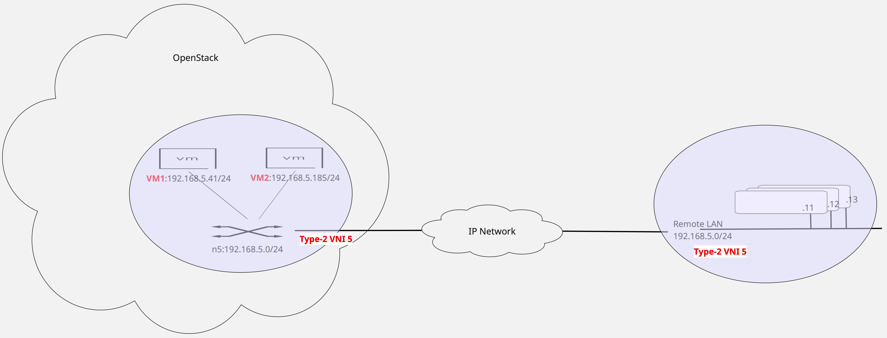
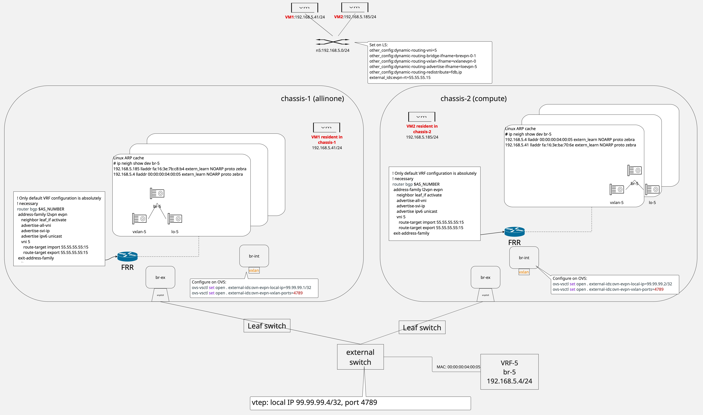

========================================================
Neutron to Provision BGP EVPN Type-2 Route Advertisement
========================================================

https://bugs.launchpad.net/bugs/2166027

Neutron introduced new EVPN Service Plugin and OVN Agent EVPN Extension in
Launchpad bug #2144617 to support BGP EVPN Type-5 route advertisement [1]_
[2]_.  This spec extends the current EVPN Service Plugin and OVN Agent EVPN
Extension to support Type-2 route advertisement.

Problem Description
===================

Neutron's existing EVPN Service Plugin provisions an OVN logical topology to
support EVPN Type-5 route advertisement and the existing OVN Agent EVPN
Extension provisions on a host Linux interfaces and FRR for BGP route
advertisement and learning.  To support EVPN Type-2 route advertisement, the
existing EVPN Service Plugin must be extended to provision OVN settings for
EVPN Type-2 route advertisement.  The changes in OVN Agent EVPN Extension
include modifying the existing finite state machine to distinguish events
related to Type-2 advertisements and handle those new events.  Each new
transition involves OVN Agent EVPN Extensions leveraging existing capability to
provision Linux interfaces to work with the connected EVPN router.

Acronyms used in this spec
==========================

- FRR: Free Range Routing (https://github.com/FRRouting/frr)
- BGP: Border Gateway Protocol
- EVPN: Ethernet VPN, first defined in RFC 7432 for IP/MPLS network and later
  updated in RFC 9135
  (https://datatracker.ietf.org/doc/html/rfc9135.html) and RFC 9136
  (https://datatracker.ietf.org/doc/html/rfc9136.html) for data center
  environments
- VRF: Virtual Routing and Forwarding, a virtual routing and forwarding domain
  that can span a wide area network.  Linux models this as a Linux route table
  and uses the term VRF synonymously with route table
- VNI: In this document, it is the 24-bit Virtual Network Identifier within
  the VxLAN header that identifies an EVPN and is frequently synonymous with
  the EVPN itself, i.e., a VNI is the EVPN identified by the VNI
- OVN: Open Virtual Network (https://www.ovn.org)
- VxLAN: Virtual eXtensible Local Area Network
- VLAN: Virtual Local Area Network
- AS: Autonomous System
- MAC: In this document, it is Ethernet Medium Access Control
- FSM: Finite State Machine
- VID: VLAN ID
- RT: BGP Route Target

Scope
=====

This spec discusses the feature EVPN Type-2 route advertisements for MAC
addresses and IPv4 and IPv6 addresses in OpenStack.  The feature relies on
OVN's support for EVPN Type-2 route advertisement, using only distributed
routing.  This feature also relies on and extends Neutron EVPN Service
Plugin [3]_ and Neutron OVN Agent EVPN Extension [4]_.

Deployment Model
================

Figure 1 illustrates the deployment model this spec supports.  A tenant's
private layer-2 network is distributed over an IP network.  EVPN Type-2 route
support allows the tenant's distributed private layer-2 network to present as a
seamless layer-2 network.

   Figure 1: The EVPN Type-2 route deployment model this spec assumes and
   supports.

Configuration File
==================

There are no new configuration file changes.  What is new is that the
configurations are now necessary on all compute hosts.

Installation Requirements
=========================

OVN 26.03.3 is necessary to support EVPN Type-2 routes advertisement.

Neutron installation must include creation of a VxLAN tunnel terminated at
each compute node.  The VxLAN tunnel uses the default VxLAN UDP port 4789.
The VxLAN tunnel is created as follows.

.. code:: text

    ovs-vsctl set open . external-ids:ovn-evpn-local-ip=$vtep_ip
    ovs-vsctl set open . external-ids:ovn-evpn-vxlan-ports=4789

Neutron deployment should include provisioning a BGP speaker using FRR on each
compute compute node as follows.

.. code::

    ! $bgp_as is configured in /etc/neutron/plugins/ml2/ovn_agent.ini
    ! This BGP router is not new and should already be part of FRR
    ! configuration, as part of the initial OVN BGP integration
    router bgp $bgp_as
     ! Enable EVPN address family
     address-family l2vpn evpn
      ! <PEER_INTFn> should already be part of the IPv4 unicast address family
      ! configuration that is not included in this snippet
      neighbor <PEER_INTF1> activate
      neighbor <PEER_INTF2> activate
      advertise-all-vni
      ! Must explicitly enable IPv6 advertisement
      advertise ipv6 unicast
     exit-address-family
    exit

Proposed Changes
================

Neutron Design
--------------

The spec proposes to extend existing EVPN Service Plugin and Neutron OVN Agent
EVPN Extension to provision new OVN options and Linux interfaces to dynamically
advertise and learn EVPN Type-2 routes.

* Modifications to Neutron API and CLI to allow a user to create a Neutron
  network associated with an EVPN VNI and to advertise MAC/IP bindings
  within the EVPN.
* Extend EVPN Service Plugin to process the new EVPN configuration to add new
  OVN options.
* Modify Neutron OVN Agent EVPN Extension's finite state machine to listen for
  new events and to subsequently provision Linux interfaces.

Figure 2 provides an overview of the objects and configurations that Neutron
provisions to realize the EVPN Type-2 deployment in Figure 1.

   Figure 2: The logical topology Neutron provisions per virtual routing and
   forwarding domain.

Changes to CLI and REST API
---------------------------

Changes to Neutron network creation are necessary to associate Neutron network
with an EVPN identified by a VNI.

Neutron network creation CLI and REST API are updated to allow for creation of
a network associated with an EVPN identified by the VNI value.  There are two
versions of the command.  One version requiring Neutron to auto-assign a VNI
from within the evpn_vni_auto_ranges is available to all users, including
non-admin users.  The other version allowing a user-specified VNI from outside
the evpn_vni_auto_ranges is available only to admin users.  In both cases,
Neutron ensures that each network has a unique VNI and informs the user if the
requested VNI is invalid instead of failing silently.

A new configuration option allows admin users to set the BGP route target
associated with the VNI, for exporting and importing EVPN routes.  This
capability improves the integration of a remote EVPN site in OpenStack into an
existing network.

New CLI options:

.. code-block:: text

    # User requests EVPN, Neutron auto-assigns VNI
    openstack network create --auto-evpn-vni <network_name>

    # Admin specifies explicit VNI (Admin-only)
    openstack network create --evpn-vni 10000 <network_name>

    # Update an EVPN network with an auto-assigned VNI
    openstack network set --auto-evpn-vni <network_name>

    # Update an EVPN network with an Admin-specified VNI (Admin-only)
    openstack network set --evpn-vni 10000 <network_name>

    # Update an EVPN network to remove VNI
    openstack network unset --evpn-vni <network_name>

    # Update an EVPN network with a BGP route target (Admin-only)
    openstack network set --evpn-rt <rt> <network_name>
    where <rt> has the pattern
    <2-byte-AS>:<4-byte-local-value>,
    <IPv4-address>:<2-byte-local-value>, or
    <4-byte-AS>:<2-byte-local-value>

    # Update an EVPN network to remove the BGP route target (Admin-only)
    openstack network unset --evpn-rt <network_name>

    # Show network VNI
    openstack network show <network_name> -c evpn-vni

REST API — Create network and auto-allocate VNI:
Must set evpn_vni to value 0 for auto-assignment

.. code-block:: text

    POST /v2.0/networks/{network_id}
    {
        "network": {
            "name": "evpn-network",
            "evpn_vni": 0
        }
    }

REST API — Create network with explicit VNI (admin-only):

.. code-block:: text

    POST /v2.0/networks/{network_id}
    {
        "network": {
            "name": "evpn-network-10000",
            "evpn_vni": 10000
        }
    }

REST API — Update network to add auto-allocated VNI:
Must set evpn_vni to value 0 for auto-assignment

.. code-block:: text

    PUT /v2.0/networks/{network_id}
    {
        "network": {
            "name": "evpn-network",
            "evpn_vni": 0
        }
    }

REST API — Update network to add explicitly requested VNI (admin-only):

.. code-block:: text

    PUT /v2.0/networks/{network_id}
    {
        "network": {
            "name": "evpn-network-10000",
            "evpn_vni": 10000
        }
    }

REST API — Update network to remove VNI:

.. code-block:: text

    PUT /v2.0/networks/{network_id}
    {
        "network": {
            "name": "evpn-network-10000",
            "evpn_vni": null
        }
    }

REST API — Update network to add a BGP route target (admin-only):
Route target pattern: <2-byte-AS>:<4-byte-local-value>,
<IPv4-address>:<2-byte-local-value>, or <4-byte-AS>:<2-byte-local-value>

.. code-block:: text

    PUT /v2.0/networks/{network_id}
    {
        "network": {
            "name": "evpn-network-10000",
            "evpn_rt": "192.168.1.1:100"
        }
    }

REST API — Update network to remove the BGP route target (admin-only):

.. code-block:: text

    PUT /v2.0/networks/{network_id}
    {
        "network": {
            "name": "evpn-network-10000",
            "evpn_rt": null
        }
    }

REST API — response (evpn_vni and evpn_rt only appear when configured):

.. code-block:: text

    # Response for EVPN network with VNI and BGP route target:
    GET /v2.0/networks/{network_id}
    {
        "network": {
            "name": "evpn-network-10000",
            "evpn_vni": 10000,
            "evpn_rt": "192.168.1.1:100",
            ...
        }
    }

    # Response for EVPN network with VNI only (no BGP route target):
    {
        "network": {
            "name": "evpn-network-10000",
            "evpn_vni": 10000,
            ...
        }
    }

EVPN Service Plugin maintains a model, either a new model or extended from an
existing model, to associate the network with a VNI.  EVPN Service Plugin also
subscribes to network lifecycle events to process the evpn_vni attribute.

EVPN Service Plugin
-------------------

The API extensions trigger EVPN Service Plugin to prepare the logical topology
for EVPN packet processing.  The logical topology includes a logical switch
corresponding to the Neutron network.  EVPN Service Plugin sets a few OVN
options on the logical switch to  marshal information to OVN chassis so that
EVPN control plane can be created and EVPN routes are advertised and learned.

The command "openstack network create --evpn-vni [<VNI>]" creates a Neutron
network for the EVPN corresponding to the specified or auto-assigned VNI,
configured to advertise the MAC/IP bindings on the network as EVPN Type-2
routes.  EVPN Service Plugin adds dynamic routing options on this logical
switch to enable EVPN.  The option dynamic-routing-vni [5]_ associates the
logical switch with the assigned or specified VNI and
dynamic-routing-redistribute [6]_ specifies the information OVN relays for
advertisement.  For EVPN Type-2 routes, it is necessary to redistribute the
FDB [7]_ and IP [8]_ such that OVN relays the MAC/IP bindings on the logical
switch to be advertised as EVPN Type-2 routes.  Much like the existing support
for EVPN Type-5 route advertisement, Linux interfaces are necessary to
ensure proper FRR BGP EVPN operations, and thus dynamic-routing-bridge-ifname
[9]_, dynamic-routing-vxlan-ifname [10]_, and
dynamic-routing-advertise-ifname [11]_ must be set in the same manner as done
for EVPN Type-5 route support.  The code block below includes all the necessary
configurations on the logical switch for OVN.  Some of the configurations,
dynamic-routing-vni, dynamic-routing-bridge-ifname,
dynamic-routing-vxlan-ifname, and dynamic-routing-advertise-ifname, are
required for each VNI, and consequently these configurations are necessary in
both EVPN Type-2 and EVPN Type-5 advertisement.  The interface naming
convention reuses the naming convention discussed in the original EVPN Type-5
specification [1]_.

.. code-block:: text

    # OVN-defined configurations to set on the logical switch corresponding to
    # the Neutron network with VNI set
    other_config:dynamic-routing-vni=$VNI
    other_config:dynamic-routing-redistribute=fdb,ip
    other_config:dynamic-routing-bridge-ifname=vl-$index-$VID
    other_config:dynamic-routing-vxlan-ifname=vxlanevpn-$index
    other_config:dynamic-routing-advertise-ifname=loevpn-$VNI
    external_id:neutron:evpn-rt=$rt

The newly introduced option to set the BGP route target for the EVPN requires
that the EVPN Service Plugin add an external_id in the logical switch to store
the configured route target.

OVN Agent EVPN Extension
------------------------

Existing Neutron OVN Agent EVPN Extension maintains a list of L3 EVPN instance
data structures.  A new L2 EVPN instance data structure is defined to track L2
EVPN instances.

.. code-block:: text

    # Extended EVPN instance class
    class L2Evpn:
        def __init__(self, vni, vid):
            self.mac = None
            self.vni = None
            self.vid = None
            self.rt = None

OVN Agent EVPN Extension does not use a finite state machine to track L2 EVPN
instances.  Instead, OVN Agent EVPN Extension is extended to monitor OVN
database events.

OVN Agent EVPN Extension registers for Datapath_Binding create, update, and
delete events with the Southbound OVN database.  OVN Agent EVPN Extension
creates an EVPN instance for each Neutron network whose corresponding logical
switch has the option dynamic-routing-vni set.  OVN Agent EVPN Extension
stores the configured VNI and the mapped VID, generates a MAC address, and
creates the necessary Linux interfaces and/or VNI/VLAN mapping, identical to
the ones created for EVPN Type-5 route advertisement [1]_.  Type-2 route
advertisement in a pure layer-2 deployment shown in Figure 1 assumes Linux
interfaces in the default VRF.  Thus, such a deployment does not require
non-default Linux VRFs or per-VRF BGP configuration, and BGP begins advertising
and learning MAC/IP bindings for the EVPN instance after the necessary Linux
interfaces and/or VNI/VLAN mapping are created.  The same L2 EVPN instance,
along with its associated Linux interfaces, is deleted when dynamic-routing-vni
is unset.

To support configurable BGP route target, the Neutron OVN Agent EVPN Extension
must connect to the Northbound OVN database and listen for logical switch
update events.  When a logical switch update event occurs, Neutron OVN Agent
EVPN Extension determines if the logical switch is associated with an EVPN
instance, i.e., has other_config:dynamic-routing-vni set.  For each logical
switch associated with an EVPN instance, OVN Agent EVPN Extension stores or
removes the route target depending on whether the neutron:evpn_rt is set or
not.  OVN Agent EVPN Extension also configurations and unconfigures BGP with
the route target based on neutron:evpn_rt.

References
==========

.. [1] Neutron to Provision BGP EVPN Type-5 Route Advertisement,
   https://github.com/openstack/neutron-specs/blob/master/specs/2026.2/bgp_evpn_type_5_route_support.rst

.. [2] EVPN Type-5 Route Advertisement development Launchpad #2144617,
   https://bugs.launchpad.net/neutron/+bug/2144617

.. [3] Neutron EVPN Service Plugin,
   https://github.com/openstack/neutron/tree/master/neutron/services/evpn
   https://bugs.launchpad.net/neutron/+bug/2144617

.. [4] Neutron OVN Agent EVPN Extension,
   https://github.com/openstack/neutron/tree/master/neutron/agent/ovn/extensions/evpn

.. [5] OVN dynamic-routing-vni,
   https://github.com/ovn-org/ovn/blob/1e8319ce05b0b669b46722eb652ddb7316f2159e/ovn-nb.xml#L956

.. [6] OVN dynamic-routing-redistribute,
   https://github.com/ovn-org/ovn/blob/1e8319ce05b0b669b46722eb652ddb7316f2159e/ovn-nb.xml#L1017

.. [7] OVN dynamic-routing-redistribute=fdb,
   https://github.com/ovn-org/ovn/blob/1e8319ce05b0b669b46722eb652ddb7316f2159e/ovn-nb.xml#L1025

.. [8] OVN dynamic-routing-redistribute=ip,
   https://github.com/ovn-org/ovn/blob/1e8319ce05b0b669b46722eb652ddb7316f2159e/ovn-nb.xml#L1036

.. [9] OVN dynamic-routing-bridge-ifname,
   https://github.com/ovn-org/ovn/blob/4bab00d57e5cc3d8d7a6670660fc8f6d63c2bdf9/ovn-nb.xml#L799

.. [10] OVN dynamic-routing-vxlan-ifname,
   https://github.com/ovn-org/ovn/blob/4bab00d57e5cc3d8d7a6670660fc8f6d63c2bdf9/ovn-nb.xml#L806

.. [11] OVN dynamic-routing-advertise-ifname,
   https://github.com/ovn-org/ovn/blob/1e8319ce05b0b669b46722eb652ddb7316f2159e/ovn-nb.xml#L976
