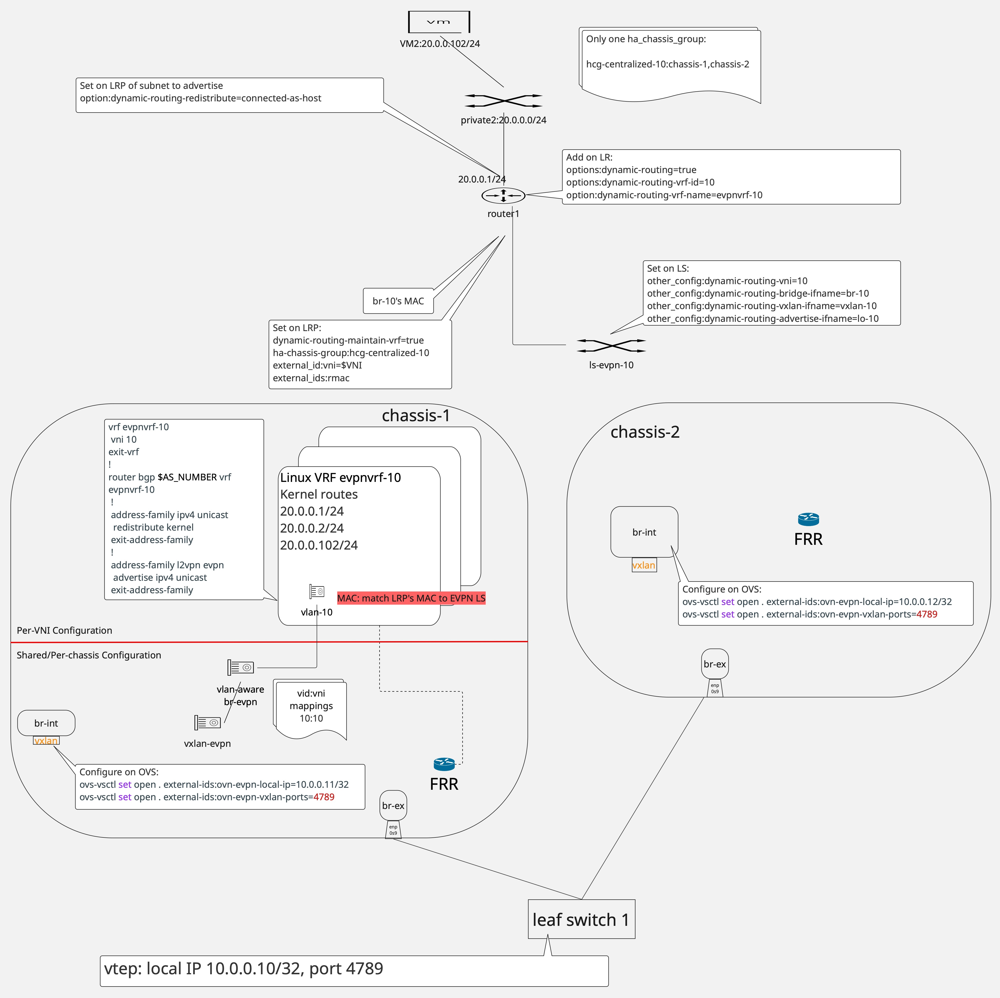
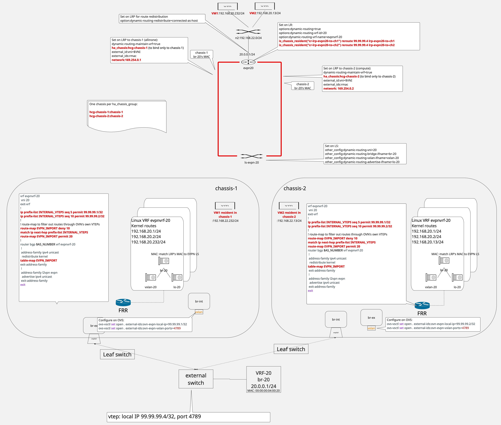

=============================================================
BGP EVPN Type-5 Route Advertisement using Distributed Routing
=============================================================

https://bugs.launchpad.net/bugs/2166025

Neutron introduced BGP EVPN Type-5 Route support using centralized routing in
Launchpad bug #2144617 [1]_ [2]_.  Using centralized routing means that the
VxLAN tunnel endpoint resides in a gateway chassis (could be a networker
node, compute node or controller), even though the workloads/VMs
are distributed across different compute nodes. Thus, EVPN traffic to/from
workloads of a particular compute node is first tunneled to the gateway
chassis and then transmitted over the network node's VxLAN tunnel [3]_.

This spec extends existing BGP EVPN Type-5 Route support to use distributed
routing, such that each compute node establishes a VxLAN tunnel endpoint. EVPN
traffic to/from the workloads within a compute node ingresses/egresses the
VxLAN tunnel directly on the compute node.

Problem Description
===================

Neutron currently supports EVPN deployments using centralized routing, where the
VxLAN tunnel endpoint is in a gateway chassis (could be a networker node,
compute node or controller) and EVPN traffic from compute nodes
must be tunneled to the network node to be transported over the VxLAN tunnel.
Such a deployment is less scalable, since all EVPN traffic must traverse the
gateway chassis.  A deployment where the VxLAN tunnel endpoints reside in every
compute node provides better performance, since EVPN traffic directly
ingresses and egresses the compute server where the workloads reside, cutting
out the extra hop to the network node.

Acronyms used in this spec
==========================

- FRR: Free Range Routing (https://github.com/FRRouting/frr)
- BGP: Border Gateway Protocol
- VPN: Virtual Private Network
- EVPN: Ethernet VPN, first defined in RFC 7432 for IP/MPLS network and later
  updated in RFC 9135
  (https://datatracker.ietf.org/doc/html/rfc9135.html) and RFC 9136
  (https://datatracker.ietf.org/doc/html/rfc9136.html) for data center
  environments
- VRF: Virtual Routing and Forwarding, a virtual routing and forwarding domain
  that can span a wide area network.  Linux models this as a Linux route table
  and uses the term VRF synonymously with route table
- VNI: In this document, it is the 24-bit Virtual Network Identifier within
  the VxLAN header that identifies an EVPN and is frequently synonymous with
  the EVPN itself, i.e., a VNI is the EVPN identified by the VNI
- OVN: Open Virtual Network (https://www.ovn.org)
- VxLAN: Virtual eXtensible Local Area Network
- MAC: In this document, it is Ethernet Medium Access Control

Scope
=====

Figure 1 illustrates the existing Neutron EVPN Type-5 route advertisement support,
leveraging the network node to be the VxLAN tunnel endpoint and to be the BGP
speaker to advertise and learn routes.  Neutron EVPN Service Plugin [4]_
provisions the OVN logical topology, while Neutron OVN agent EVPN Extension [5]_
provisions the network node with Linux devices and BGP.

   Figure 1: The logical topology Neutron provisions per virtual routing and
   forwarding domain.

This spec discusses extensions to the existing EVPN Type-5 support in Neutron
to support distributed routing such that EVPN traffic ingresses/egresses a
compute node where the workloads reside.  The design extends the existing
Neutron EVPN Service Plugin to create the new OVN logical topology in Figure
2, with the differences highlighted in red.

   Figure 2: New logical topology to support distributed routing.

Configuration File
==================

Support for distributed routing requires the compute nodes to also have FRR
installed.  To guard against a deployment without FRR installed on the compute
nodes, the ML2/OVN plugin configuration file on the server, ml2_conf.ini,
includes a new boolean option, ``enable_evpn_distributed``, in a new ``[evpn]``
section.  When ``enable_evpn_distributed=true``, all compute nodes are assumed
to have FRR installed and the EVPN Service Plugin supports distributed routing.

.. code:: text

    [evpn]
    enable_evpn_distributed = true

Each networker and compute node should enable the EVPN extension in the OVN
Agent.  Each networker and compute node's OVN Agent configuration file,
ovn_agent.ini, includes an ``[ovn_evpn]`` section providing BGP configuration
to the OVN Agent EVPN extension.

.. code:: text

    [ovn_evpn]
    bgp_local_interface = leaf_if
    bgp_as = 64999

Installation Requirements
=========================

OVN 26.09 is necessary to support distributed routing.  FRR 10.6 is required
on all networker and compute nodes.

Neutron installation must include creation of a VxLAN tunnel terminated at
each compute host.  The VxLAN tunnel uses the default VxLAN UDP port 4789.
The VxLAN tunnel is created as follows, the same way as the VxLAN created for
centralized routing.

.. code:: text

    ovs-vsctl set open . external-ids:ovn-evpn-local-ip=$vtep_ip
    ovs-vsctl set open . external-ids:ovn-evpn-vxlan-ports=4789

Each compute node should have FRR provisioned at start up.  Specifically, BGP
should be provisioned in the default namespace, the same as is done for
centralized routing.  Additionally, new for distributed routing, FRR
configuration includes a prefix-list and a route-map, later used by each VNI
to filter out routes local to OpenStack.  The prefix-list and the route-map
are compatible with centralized routing, since they are not active until they
are applied to a BGP router.

.. code::

    ! prefix-list INTERNAL_VTEPS used in the route-map to ignore certain routes
    ip prefix-list INTERNAL_VTEPS seq 11 permit <COMPUTE_1_VTEP_IP>
    ip prefix-list INTERNAL_VTEPS seq 12 permit <COMPUTE_2_VTEP_IP>
    !
    ! route-map to filter out routes through OVN's own VTEPs
    route-map EVPN_IMPORT deny 10
      match ip next-hop prefix-list INTERNAL_VTEPS
    route-map EVPN_IMPORT permit 20
    !
    ! $bgp_as is configured in /etc/neutron/plugins/ml2/ovn_agent.ini
    ! This BGP router is not new and should already be part of FRR
    ! configuration, as part of the initial OVN BGP integration
    router bgp $bgp_as
     ! Enable EVPN address family
     address-family l2vpn evpn
      ! <PEER_INTFn> should already be part of the IPv4 unicast address family
      ! configuration that is not included in this snippet
      neighbor <PEER_INTF1> activate
      neighbor <PEER_INTF2> activate
      ! Must explicitly enable IPv6 advertisement
      advertise ipv6 unicast
      advertise-all-vni
     exit-address-family
    exit

Proposed Changes
================

The spec proposes a new API and CLI option to enable EVPN Type-5 advertisement
using distributed routing and changes to the existing Neutron EVPN Service
Plugin to support it.

* Modify Neutron API and CLI to enable a new or existing EVPN router to use
  distributed routing.
* Modify EVPN Service Plugin to process the new configuration, storing
  necessary EVPN information and adjusting OVN logical topology for EVPN.
* Modify OVN Agent EVPN Extension to apply route-map to the per-VNI BGP
  configuration.

Changes to CLI and REST API
---------------------------

The Neutron server configuration ``enable_evpn_distributed=true`` is mandatory
to enable the CLI and API to provision distributed routing.  When
``enable_evpn_distributed`` is not set to true, the server will reject any
operation to create or set an EVPN router to use distributed routing.

Neutron router creation CLI and REST API are updated to allow for creation of
an EVPN router, a Neutron router with an associated VNI value, to use
distributed routing.  There are two
versions of the command, one where Neutron auto-assigns a VNI from within the
evpn_vni_auto_ranges, and one where the command specifies a VNI from outside
the evpn_vni_auto_ranges.  In both cases, Neutron ensures that each router has
a unique VNI and informs the user if the requested VNI is invalid instead of
failing silently.  By default, both commands are restricted to the cloud
administrator.

In addition to the command to create an EVPN router using distributed routing,
an existing EVPN router is also allowed to be updated to use distributed
routing.  This ability to update an existing EVPN router to use distributed
routing allows for migration from an older version of Neutron supporting only
centralized routing to a newer version of Neutron supporting distributed
routing.  Using a make-before-break approach, where the new distributed
routing logical topology is wired up before the centralized routing logical
topology is torn down, potentially reduces traffic loss during such a
migration.

New CLI options:

.. code-block:: text

    # User requests EVPN with distributed routing, Neutron auto-assigns VNI
    # --auto-evpn-vni is an existing option
    openstack router create --auto-evpn-vni --evpn-distributed <router_name>

    # Admin specifies explicit VNI with distributed routing
    # --evpn-vni is an existing option
    openstack router create --evpn-vni 10000 <router_name>

    # Update an EVPN router to use distributed routing
    openstack router set --evpn-vni 10000 --evpn-distributed <router_name>

    # Update an EVPN router to use default centralized routing, not
    # distributed routing
    openstack router unset --evpn-vni 10000 --evpn-distributed <router_name>

    # Show router use of distributed routing
    openstack router show <router_name> -c evpn-distributed

The existing REST API creates an EVPN router using default centralized routing:

.. code-block:: text

    POST /v2.0/routers
    {
        "router": {
            "name": "evpn-router-10000",
            "evpn_vni": 10000
        }
    }

New REST API creates an EVPN router using distributed routing:

.. code-block:: text

    POST /v2.0/routers
    {
        "router": {
            "name": "evpn-router-10000",
            "evpn_vni": 10000,
            "evpn_distributed": true
        }
    }

New REST API updates the EVPN router to use distributed routing:

.. code-block:: text

    PUT /v2.0/routers/{router-id}
    {
        "router": {
            "name": "evpn-router-10000",
            "evpn_distributed": true
        }
    }

New REST API updates the EVPN router to not use distributed routing:

.. code-block:: text

    PUT /v2.0/routers/{router-id}
    {
        "router": {
            "name": "evpn-router-10000",
            "evpn_distributed": false
        }
    }

REST API response always displays the state of distributed routing:

.. code-block:: text

    GET /v2.0/routers/{router_id}
    {
        "router": {
            "name": "evpn-router-10000",
            "evpn_vni": 10000,
            "evpn_distributed": true (or false),
            ...
        }
    }

EVPN Service Plugin
-------------------

The API extensions trigger EVPN Service Plugin to create an OVN logical
topology in Figure 2 to support distributed routing.  The changes necessary to
support distributed routing are highlighted in red.  The existing EVPN Service
Plugin creates a logical topology consisting of the existing EVPN logical
router, the existing dummy EVPN logical switch, and for each chassis a logical
router port bound to that chassis that connects the EVPN router to the dummy EVPN
switch.  To bind the a logical router port to a chassis, the EVPN Service
Plugin creates one HA_Chassis_Group per chassis, where the HA_Chassis_Group
consists of only one single chassis.  Then, one logical router port is bound
to one HA_Chassis_Group.

Like with centralized routing, EVPN Service Plugin sets the
dynamic-routing-maintain-vrf [6]_ option on these bound logical router ports
to cause OVN to create a Linux VRF device on each chassis.
New for distributed routing is that EVPN Service Plugin assigns a network
to each bound logical router port to cause OVN to generate rules for the
new reroute policies.

.. code-block:: text

    # Set on each of EVPN logical router's logical router port connecting to
    # a chassis router
    options:dynamic-routing-maintain-vrf=true
    networks=$nexthop_i

For distributed routing, EVPN Service Plugin adds to the EVPN logical router
a reroute policy for each chassis.  The reroute policy use the
bound logical router ports to determine within which chassis the VM traffic is
from and to set the output port to the local logical router port.  This is the
key to keeping traffic from a VM within its resident chassis so that the
traffic egresses from the local compute node.  Until OVN supports reroute policy
with indirect nexthop, Neutron must monitor OVN Southbound database's
MAC_Binding table for the remote VTEP's IP learned on each bound logical router
port and statically provision the remote VTEP's IP as the nexthop in the
reroute policy.

.. code-block:: text

    # New reroute policies to route traffic to the resident chassis router,
    # where $nexthop_i is a network configured on the logical router port to a
    # chassis router
    ovn-nbctl lr-policy-add router1 \
        'inport == "$lrp_to_advertising_subnet" && \
         is_chassis_resident("$cr_lrp_to_chassis_i")' \
        reroute $remote_vtep_ip $lrp_to_chassis_i

While the dummy logical switch is connected differently when using distributed
routing, there are no changes to its configurations.

Existing EVPN support uses the command "openstack router add subnet
--advertise-host" to trigger the EVPN instance created above to advertise
prefixes within a Neutron subnet.  When a Neutron subnet is added to an EVPN
router with the advertise option, EVPN Service Plugin sets the
dynamic-routing-redistribute=connected-as-host [7]_ on the corresponding OVN
logical router port to instruct OVN to add host routes from this subnet to the
Linux route table corresponding to the logical router.  When distributed
routing is enabled, EVPN Service Plugin adds to the logical port the new option
dynamic-routing-redistribute-local-only=true to indicate that only prefixes of
workloads in the local compute node should be advertised.

In addition to building the EVPN logical topology at the time an EVPN router
is created or set to use distributed routing, the EVPN Service Plugin also
monitors for Chassis creation and deletion events.  When a new Chassis is
created, the EVPN Service Plugin adds the new Chassis into the topology by
creating a new logical router port bound to the new Chassis to connect the
EVPN logical router to the dummy switch.  When an existing Chassis is deleted,
the EVPN Service Plugin removes the logical router port bound to that Chassis
from the logical topology.

.. code-block:: text

    # Existing option set on the logical router port
    options:dynamic-routing-redistribute=connected-as-host

    # New option to advertise only prefixes local to the compute node
    options:dynamic-routing-local-only=true

OVN Agent EVPN Extension
------------------------

There is only one change in OVN Agent EVPN Extension to support distributed
routing.  When provisioning BGP router for an EVPN instance, i.e., for a VNI,
OVN Agent EVPN Extension applies the route-map EVPN_IMPORT to the BGP router.
This route-map is created during FRR deployment.  Applying the route-map to
the BGP router for the VNI causes the BGP router to not add the prefixes local
to OpenStack to each chassis.  Traffic originating from OpenStack destined
to prefixes local to OpenStack continues to use native OVN routing and
forwarding, instead of using dynamic routing from BGP.

Thoughts on Migrating between Centralized and Distribute Routing
----------------------------------------------------------------

This document introduces an API to change an EVPN instance from using
centralized routing to distributed routing and vice versa.  Migrating between
centralized routing and distributed routing means changing where BGP EVPN
Type-5 routes are learned and advertised.  Thus, ensuring that routes are
learned and advertised in BGP in the new networker node when migrating from
distributed to centralized routing or in the new compute nodes when migrating
from centralized to distributed routing, prior to removing the previous routes
helps to reduce traffic loss.  Manipulating BGP's route metric and leveraging
OVN's dynamic-routing-no-learning=true option potentially helps to prevent
these newly advertised and learned routes from being actively used.

References
==========

.. [1] Launchpad bug #2144617 BGP EVPN type-5 route advertisement with
   centralized routing, https://bugs.launchpad.net/neutron/+bug/2144617

.. [2] Proposed specification for BGP EVPN Type-5 route route advertisement
   with centralized routing,
   https://github.com/openstack/neutron-specs/blob/master/specs/2026.2/bgp_evpn_type_5_route_support.rst

.. [3] VxLAN, https://datatracker.ietf.org/doc/rfc7348/

.. [4] Neutron EVPN Service Plugin,
   https://github.com/openstack/neutron/tree/master/neutron/services/evpn

.. [5] Neutron OVN Agent EVPN Extension,
   https://github.com/openstack/neutron/tree/master/neutron/agent/ovn/extensions/evpn

.. [6] OVN dynamic-routing-maintain-vrf,
   https://github.com/ovn-org/ovn/blob/4bab00d57e5cc3d8d7a6670660fc8f6d63c2bdf9/ovn-nb.xml#L4492

.. [7] OVN dynamic-routing-redistribute,
   https://github.com/ovn-org/ovn/blob/4bab00d57e5cc3d8d7a6670660fc8f6d63c2bdf9/ovn-nb.xml#L3307
